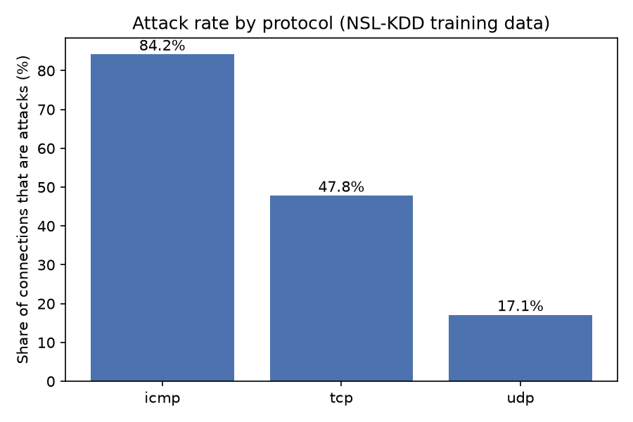
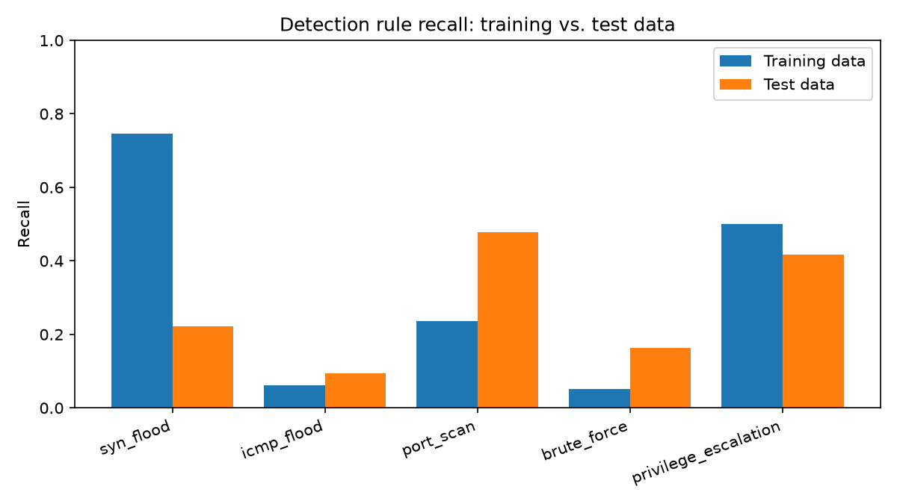

cat > README.md <<'EOF'
# Network Intrusion Analyzer

SQL analysis, detection rules, and a machine learning baseline over the
NSL-KDD benchmark dataset (about 126,000 labeled network connections).
The project asks one question: how well do simple, readable detection rules
hold up against a machine learning model on attacks they have not seen?

## What it does

1. **Loads** the dataset into SQLite and groups attack labels into four
   families: DoS, Probe, R2L (remote-to-local), and U2R (user-to-root).
2. **Analyzes** it with SQL (CTEs, window functions, grouped queries).
3. **Detects** with five rules written as code, each mapped to a MITRE ATT&CK
   technique and scored for precision and recall.
4. **Compares** the rules with a random forest trained on the training file and
   scored on a separate test file with unseen attack variants.
5. **Tests** the rules and loader with pytest, run automatically by GitHub Actions.

## Setup

    pip install -r requirements.txt
    mkdir -p data
    curl -L -o "data/KDDTrain+.txt" "https://raw.githubusercontent.com/defcom17/NSL_KDD/master/KDDTrain%2B.txt"
    curl -L -o "data/KDDTest+.txt" "https://raw.githubusercontent.com/defcom17/NSL_KDD/master/KDDTest%2B.txt"
    python3 src/load_data.py
    python3 src/run_queries.py
    python3 src/evaluate_rules.py
    python3 src/ml_baseline.py
    python3 src/make_charts.py
    python3 -m pytest

## Findings

**SQL analysis (training data)**

- ICMP traffic is 84.2% attacks, TCP 47.8%, UDP 17.1%.
- 74.8% of DoS connections end with flag `S0` (a SYN that never got an answer),
  compared with 0.5% of normal traffic. This is the signature of a SYN flood.

**Detection rules (training data)**

| Rule | ATT&CK | Precision | Recall |
|---|---|---|---|
| syn_flood | T1498.001 | 0.998 | 0.747 |
| icmp_flood | T1498 | 0.998 | 0.062 |
| port_scan | T1046 | 0.903 | 0.236 |
| brute_force | T1110 | 0.426 | 0.052 |
| privilege_escalation | T1068 | 0.144 | 0.500 |

Together the rules catch about 68% of attacks with 99% precision. Rules that
look accurate can still miss most attacks: the ICMP rule is precise but has
6% recall.

**Rules vs. random forest (separate test file)**

On the test file, which contains attack variants not in the training data:

- The random forest reaches about 75% overall accuracy. It is strong on DoS
  (precision 0.96, recall 0.80) and decent on Probe (recall 0.60), but it
  catches only 2% of R2L attacks and 1% of U2R attacks.
- The hand-written rules also change on unseen data. The SYN flood rule's
  recall falls from 0.747 to 0.223, while the port scan rule's rises from
  0.236 to 0.477.

**Takeaway:** neither approach is clearly better. Both are strong on
high-volume attacks (DoS, Probe) and weak on rare, subtle ones (R2L, U2R).
Results on the training data overstate how well either would work on new
attacks.

## Limitations

- NSL-KDD is a benchmark derived from 1999-era research traffic. It does not
  reflect modern traffic or attacks.
- Rule thresholds were chosen by hand using the training data.
- The random forest uses default settings and a single run; it was not tuned.
- The ATT&CK technique mappings are approximate.
EOF